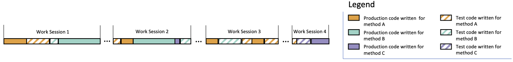
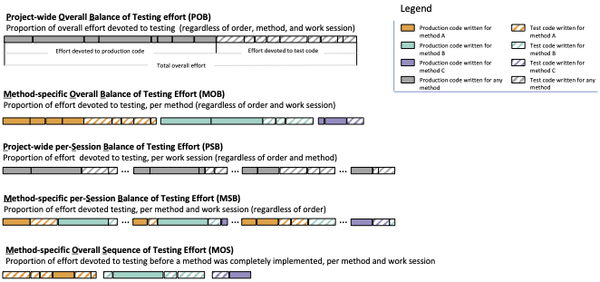
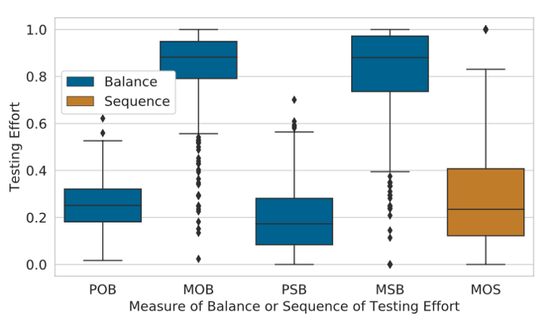

<small>
*This article was originally posted on [my Medium blog](https://ayaankazerouni.medium.com) on July 7 2020.*
</small>

*This is a brief overview of the research paper "__[Assessing Incremental Testing Practices and Their Impact on Project Outcomes]({{ '/publications#sigcse2019paper' | absolute_url }})__", published at SIGCSE 2019. My co-authors were [Cliff Shaffer](https://people.cs.vt.edu/~shaffer), [Steve Edwards](https://people.cs.vt.edu/~edwards), and [Francisco Servant](https://people.cs.vt.edu/~fservant).*

Software testing is the most common method of ensuring the correctness of software. As students work on relatively long-running software projects, we would like to know if they are engaging with testing consistently through the life-cycle. The long-term goal is to provide students with feedback about their testing habits as they work on projects.

This post is aimed at computing educators, researchers, and engineers.

We examined the programming effort applied by students during (unsupervised) programming sessions as they worked on projects, and measured the proportion of that effort that was devoted to writing tests. This measurement is useful because it lets us avoid the “test-first” or “test-last” dichotomy and allowed for varying styles and levels of engagement with testing over time. It can also be easily measured in real-time, facilitating automated and adaptive formative feedback.

## Summary

### Goal
* To assess a student’s software testing, not just their software tests
* To understand how various levels of engagement with testing relate to project outcomes

### Method
* Collect high-resolution project snapshot histories from consenting students’ IDEs and mine them for insight about their testing habits
* Test the relationships between students’ testing habits and their eventual project correctness and test suite quality

### Findings
Unsurprisingly, we found that when more of each session’s programming effort was devoted to testing, students produced solutions with higher correctness and test suites with higher condition coverage. We also found that project correctness was unrelated to whether students did their testing before or after writing the relevant solution code.

Our findings suggest that the incremental nature of testing was more important than whether the student practiced “test-first” or “test-last” styles of development. The within-subjects nature of our experimental design hints that these relationships may be causal.

## Motivation
Students and new software engineering graduates often display poor testing ability and a disinclination to practice regular testing.[^1] It is now common practice to require unit tests to be submitted along with project solutions. But it is unclear if students are writing these tests incrementally as they work toward a solution, or if they are following the less desirable “code a lot, test a little” style of development.

Learning a skill like incremental testing requires practice, and practice should be accompanied by feedback to maximise skill acquisition. But we cannot produce feedback about practice without observing it. We conducted a study in our third-year Data Structures & Algorithms course to (1) measure students’ adherence to incremental test writing as they worked on large, complex programming projects, and (2) understand the impact that their test writing practices had on project outcomes.

We focused on addressing two challenges to the pedagogy of software testing:
First, existing testing feedback tends to focus on product rather than process. That is, assessments tend to be driven by “post-mortem” measures like code coverage, all-pairs execution, or (rarely) mutation coverage achieved by students’ submissions. Students’ adherence to test-oriented development processes as they produce those submissions is largely ignored.

We addressed this by measuring the balance of students’ test writing vs. solution writing activities as they worked on their projects. If we can reliably measure students’ engagement with testing as they work on projects, we can provide formative feedback to help keep them on track in the short term, and help them form incremental testing habits in the long term.

Second, there is a lack of agreement on what constitutes effective testing process. Numerous researchers have presented (often conflicting[^2] [^3]) evidence about the effectiveness of test-driven development (TDD) and incremental test-last (ITL) styles of development. But these findings may not generalise to students learning testing practices, and the conflicting evidence muddies the issue of what exactly we should teach or prescribe.
We addressed this by avoiding the “TDD or not” dichotomy. Students’ (and indeed, professionals’) engagement with testing does not stay consistent over time, either in kind or in volume [^4] [^5]. Therefore, we didn’t attempt to classify student work as following TDD or not. Instead, we measured the extent to which they balanced their test writing and solution writing activities for increments of work over the course of their projects. This allowed us to more faithfully represent and study their varying levels of engagement with testing as they worked toward solutions.

## Measuring Incremental Test Writing

### Context and data collection
Students in our context are working on software projects that are larger and more complex than what they have encountered in previous courses. Success usually necessitates adherence to disciplined software process, including time management and regular testing. We studied roughly 150 students working on 4 programming assignments over a semester (~3.5 month period).

We used an [Eclipse plugin](https://github.com/web-cat/eclipse-plugins-importer-exporter/tree/DevEventTrackerAddition) to automatically collect frequent snapshots of students’ projects as they worked toward solutions. This snapshot history allowed us to paint a rich picture of a project’s evolution. In particular, it let us look at how the test code and solution code for a project emerged over time.

### Proposed measurements of testing effort
Using these data, we measured the balance and sequence of students’ test writing effort with respect to their solution writing effort. I describe these measurements below.

Consider the following figure, which shows an example sequence of developer activity created from synthetic data. Colours indicate methods in the project; solid and shaded blocks are solution and test code, respectively; and groups of blocks indicate work sessions.

<figure>

<figcaption>
An example sequence of developer activity (synthetic data).
</figcaption>
</figure>

We can derive measurements of balance and sequence of testing with this synthetic data in mind.
The measures are summarised in the next figure.

In terms of **balance**, we considered testing effort in terms of _space_ (methods in the project), _time_ (work sessions), _both_, or _neither_.

* **Neither**: how much total testing took place over the course of the project and its lifecycle? (POB in the figure below)
* **Space only**: how much testing took place for each method in the project? (MOB)
* **Time only**: how much testing took place during each work session? (PSB)
* **Both time and space**: how much testing took place for each method during each work session? (MSB)

Each measurement is a proportion, i.e., the proportion of all code — written in a work session or for a method or on the entire project — that was test code. So if a student wrote 100 LoC in a work session, and 20 of them were test code, the proportion for that work session would be 0.2.

In terms of **sequence**, we measured the extent to which students tended to write test code before finalising the solution code under test (MOS below).
This was measured as the proportion of test code devoted to a method that was written before the method was finalised (i.e., before it was changed for the last time).

Note that this is different from measuring adherence to "TDD or not".
Instead of classifying a student’s work (in a work session, or on a method, etc.) as strictly test-first or test-last, we measure this concept on a continuous scale.
This allows a more nuanced discussion of students’ tendencies to write test code earlier or later with respect to the solution code that is being tested.

Measurements are depicted in the figure below. All measurements were aggregated as medians for each project.

<figure>

<figcaption>
Measurements to be derived from a programming activity stream. Each row depicts a different way of aggregating the events from the figure above.
</figcaption>
</figure>

## Findings

With these measurements in hand, we are able to examine students’ incremental testing practices and their impacts on project outcomes.

### To what extent did students practice incremental testing?

Using the measurements we described, we can make observations about how students distributed their testing effort as they worked on projects.

The measurements are summarised in the figure below. The first four box-plots (in blue) represent measures of the balance of test writing effort. The fifth box-plot (in orange) represents proportion of test writing effort devoted before the relevant solution code was finalised.

<figure>

<figcaption>
Distributions of testing effort measurements described above.
</figcaption>
</figure>

Our findings were as follows.

**Balance of testing effort**

* Students tended to devote about 25% of their total code writing effort to writing test code *(POB)*
* Within individual work sessions, a majority of students devoted less than 20% of their coding effort to writing tests *(PSB)*
* The median method seemed to received a considerable amount of testing effort (*MOB*, *MSB*), possibly attributable to the way we tied solution methods and test methods together [^6]

The lower proportions of testing effort observed per work session, relative to the total project testing effort, suggests that some sessions tend to see more testing effort than others. [Prior work](https://ayaankazerouni.github.io/assets/publications/quantifying-incremental-development-procrastination.pdf) suggests that this increased testing tends to take place toward the end of the project life-cycle, to satisfy condition coverage requirements imposed on students as part of the programming assignments.

**Sequence of testing effort**

* In an overwhelming majority of submissions (85%), students tended to do their testing after the relevant solution methods were finalised (*MOS*)

### How did project outcomes relate to the balance and sequence of test writing activities?

We measured the relationship between the measurements described above and two outcomes of interest:

* _Correctness_, measured by an instructor-written oracle of reference tests
* _Code coverage_, measured as the condition coverage achieved by the student’s own test suite

We used linear mixed-effects models, with the outcome of interest as a dependent variable and the testing measurements as the independent variables.
This allowed us to tease out the variance in project outcomes that was explained by traits inherent to individual students.

We found that:
* Students produced higher quality solutions and tests when they devoted a higher proportion of their programming effort in each session to writing tests
* Whether this testing occurred before or after the relevant solution code was written was irrelevant to project correctness

We also found a _negative_ relationship between doing more testing before finalising solution code and condition coverage scores.
We do not think this means that _testing first is bad_&mdash;more likely this is an effect of students adding tests to nearly complete projects to drive up condition coverage, which made up part of their grade.
Incentives beget behaviours!

Note that, after teasing out the variance explained by inherent variability in the students (conditional $$R^2$$ in the paper), our measurements explained an ultimately small percentage of variance in project correctness and condition coverage (marginal $$R^2$$ in the paper).
More variance in outcomes can possibly be explained by any number of unaccounted-for factors.
It is also possible that projects in the Data Structures course we studied didn’t "hit the right switches" in terms of depending on regular testing for success.

## Conclusions

Our findings largely support the conventional wisdom about the virtues of regular software testing.
We did not find support for the notion that writing tests first leads to better project outcomes.

Traits or situations inherent to individual students are unlikely to have affected our results.
Students’ differing behaviours _and_ outcomes could both be symptoms of some other unknown factors (e.g., prior programming experience, differing demands on time).
Therefore, we used _within-subjects_ comparisons&mdash;i.e., assignments served as repeated measures for each student.
Each student’s work on a given project was compared to their own work on other projects, and differences in testing practices and project outcomes were observed.

The primary contribution of this work is that we are able to measure a student’s adherence to these practices with some lead time before final project deadlines.
The short-term benefit of this is that we can provide feedback to students "before the damage is done", i.e., before they face the consequences of poor testing practices that we have measured and observed.

In the long-term, we think that formative feedback about testing, delivered as students work on projects, can help them to form disciplined test-oriented development habits.

---

[^1]: [Radermacher, 2013](https://dl.acm.org/doi/10.1145/2445196.2445351)
[^2]: [Fucci, 2017](https://ieeexplore.ieee.org/abstract/document/7592412?casa_token=EairhmqPPOgAAAAA:ag2Z44va8LgKn-K5NhAhDLFyn-nmTRksrVGQTMvB2qftTlfS94O1FZZyClPDUvT8qM011tfC_ls)
[^3]: [Bhat, 2006](https://dl.acm.org/doi/10.1145/1159733.1159787)
[^4]: [Beller, 2015](https://inventitech.com/assets/publications/2017_beller_gousios_panichella_amann_proksch_zaidman_developer_testing_in_the_ide_patterns_beliefs_and_behavior.pdf)
[^5]: [Beller, 2015a](https://inventitech.com/assets/publications/2017_beller_gousios_panichella_amann_proksch_zaidman_developer_testing_in_the_ide_patterns_beliefs_and_behavior.pdf)
[^6]: Solution methods were tied to test methods if they were directly invoked in the test method. So whether or not an invoked method was the “focal method” of the test, it was treated as “being tested”. This could have inflated results for methods that were commonly used to set up test cases.
