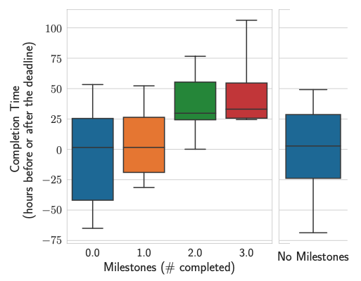
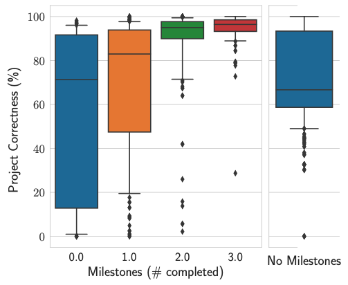
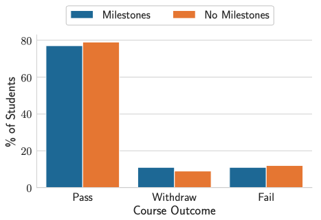
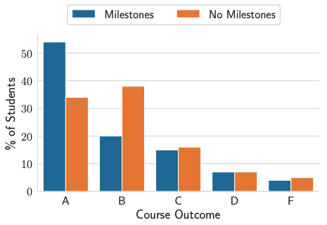

<small>
<i>This article was originally posted on [my Medium blog](https://ayaankazerouni.medium.com) on October 14, 2020.</i>
</small>

*This is an overview of the research paper "__[The Impact of Programming Project Milestones on Procrastination, Project Outcomes, and Course Outcomes]({{ '/publications#sigcse2021milestones' | absolute_url }})__" by [Cliff Shaffer](https://people.cs.vt.edu/shaffer) and myself, appearing at SIGCSE 2021.*

## Summary

Undergraduate CS students often lack experience working on large, un-scaffolded, and long-running software projects. When they encounter such projects for the first time in intermediate programming courses, they do so without any procedural knowledge for how to go about tackling them. As a result, many of them struggle to complete these projects on time or correctly. As educators, we can do a better job supporting students as they approach these projects.

We started giving students explicit project milestones with intermediate deadlines, to go with software project specifications in a third-year Data Structures course. The goal is to give students guided practice with project decomposition, time management, and successful project completion.

In a quasi-experiment to determine the impact that milestones had on timeliness, project correctness, and course outcomes, we found that:
* Milestones had a considerably strong effect on timeliness, reducing the rate of late submissions by nearly 30%
* Students with milestones produced projects with slightly higher correctness than students without milestones
* Milestones had little effect on frequencies of course outcomes, with its positive effects limited to the “students in the middle”. Unfortunately, just as many students failed the course, and just as many students withdrew from the course, with or without milestones.

Read on for more information.

## Background

Students in intermediate programming courses often work on large, un-scaffolded, and relatively long-running software projects. These tend to be larger and more complex than projects they have worked on in the past, and consequentially bring with them a set of self-regulatory challenges that the students may be ill-equipped to deal with. No longer are assignment specifications given as easy-to-approach bullet-lists of requirements. Instead, they’re presented with a “wall of prose” from which they must extract requirements, plan their development, and get to work.

An expert software developer has the domain-specific self-regulatory skills to tackle such a project. She can decompose such a project into sub-goals and budget the time needed to tackle each one. Novices, however, are often unable to do this decomposition themselves, and are famously poor at estimating the time needed for a development task [^1]. So instead, they are left facing the project with no clear place to start, low self-efficacy regarding their ability to finish, and not much prior experience from which to draw strategies or confidence.

A common manifestation of students’ ill-preparedness to approach these projects is procrastination, the “quintessential self-regulatory failure”[^2]. According to Science, there are many reasons for procrastination. Chief among them are task-related reasons. For example, we know that people are more likely to procrastinate:
* when the task’s outcome is expected farther in the future[^3],
* when they have low expectancy of successfully completing the task[^3], and
* when the task offers numerous junctures for decision-making (e.g., the student doesn’t know where to start)[^4]

Can we use this knowledge to reduce the frequency of procrastination on these projects and ameliorate its negative effects? I previously wrote about the pervasive and pernicious nature of procrastination in this context—students start late, work late, and finish late, often resulting in degraded project outcomes.

In this post, I describe a simple classroom intervention that helped reduce the rate of late submissions on programming projects by about 30%, and helped improve class performance in the intermediate Data Structures and Algorithms (DSA) course at Virginia Tech.

## Explicit project milestones

Our intermediate DSA course involves three to four programming projects, each of which is worked on for about a month. Each project requires students to build one or more interacting data structures—for example, a hash table or a PR quad-tree. Projects are un-scaffolded (no starter code) and students are free to design their own solutions. They are allowed to make as many submissions as they like to our auto-grader, which tests their solutions using acceptance tests written by the course staff.

Unfortunately, these projects usually have distressingly high rates of late submissions and failing grades, and about 25–30% of students either fail or withdraw from the course.

We believe that poor self-regulation and project management (often manifesting as procrastination) may be a significant contributor to these poor outcomes. Therefore, we instituted explicit project milestones—we broke down projects into sub-tasks that students needed to complete by intermediate deadlines. We expected to observe reduced procrastination stemming from
* outcomes that are too far in the future to be valued in the present,
* students not being able to decompose a large engineering task into manageable sub-tasks, and
* low expectancy of success, because completing each successive sub-task is likely to increase the student’s self-efficacy regarding the larger overarching task

The milestones themselves were pretty straightforward, and checkable using our auto-grading infrastructure. For any given data structure (or database made up of interacting data structures), they were as follows:
* **Milestone 1**: Make a first submission to the auto-grader (speaking as a former instructor for this course, this was surprisingly effective at making students start thinking about the project early)
* **Milestone 2**: Complete the insertion operation
* **Milestone 3**: Complete the search and update operations
* **Final submission**: Complete the removal operation

Done in that order, the removal operation is completed last. This is good because removal is often the hardest-to-implement operation in many data structures, involving complex structural rearrangements (e.g., re-ordering a binary search tree, or re-balancing a B+ tree). Our hope is that the experience of successfully completing the other, simpler operations a week or two earlier helps build the student’s self-efficacy regarding the more difficult sub-task ahead.

## How helpful were the milestones?
We instituted Milestones in the Spring of 2016. We are interested in knowing if the milestones had any impact on procrastination, project outcomes, or course outcomes. So we compared outcomes in the “milestones semester” (Spring 2016) with outcomes in a “no milestones semester”—Fall 2013. In Fall 2013, the course was taught by the same instructor (Cliff), and the projects were of comparable difficulty. In terms of LoC and cyclomatic complexity, there were no differences between project submissions in the two semesters.

We measured differences in terms of timeliness, project correctness, and course outcomes. I present a high-level overview of our results below. More details can be found in the paper.

### Timeliness

Milestones were pretty effective! We measured the rate of late submissions and the time of project completion for the two semesters. We checked for differences between the two semesters as well as differences within the milestones semester based on the number of milestones completed.
* The rate of late submissions dropped from 41% without milestones to 12% with milestones
* Within the treatment semester, students who completed 0 or 1 milestones tended to finish on the day of or after the deadline, while students who completed 2 or 3 milestones tended to finish their projects a day or more before the deadline

Results are summarised in the figure below.

<figure>
  
  <figcaption>Completion times (in terms of hours before or after the deadline) with and without milestones. Whiskers are the 10th and 90th percentiles. Outliers beyond these percentiles are omitted.</figcaption>
</figure>

### Project correctness

As I stated above, a lack of self-efficacy or discipline-specific procedural knowledge may be contributing to students’ poor outcomes on these projects. In addition to late submissions, students are prone to submitting incorrect or inadequately tested solutions. So we checked to see if milestones had any impact on project correctness.

Project correctness was defined as the percentage of instructor-written acceptance tests that the student’s submission passed. We checked for differences in correctness between submissions in the two semesters, and differences within the milestones semester based on the number of milestones completed.

* The mean correctness score increased slightly, from 72% (sd = 20%) without milestones to 76% (sd = 21%) with milestones
* Students who completed 2 or more milestones tended to produce projects with higher correctness than those who completed fewer milestones

<figure>
  
  <figcaption>Correctness scores with and without milestones</figcaption>
</figure>

### Course outcomes
Having seen that milestones had a positive impact on timeliness and correctness, we now turn to course outcomes.

**First**, we examine the pass, fail, and withdrawal rates in the course.

Students at our institution tend to find this course challenging, and it is common to see 25–30% of students withdraw from the course or fail to achieve a grade that will let them progress on to subsequent courses.

Success in the course is largely driven by success on the projects, and students may be withdrawing from the course based on early bad outcomes. So did milestones help to brighten this gloomy picture?

Sadly, no.

We first checked for differences in the frequency of the following course outcomes:
* *Pass*, where the student achieved a grade that let them move on in the major
* *Fail*, where the student completed the course, but would need to take it again before moving on
* *Withdraw*, where the student did not complete the course[^5]

<!-- [1](#1-sink) -->

We didn’t find any differences in these outcomes between the two semesters. This is apparent in the figure below.

<figure>
  
  <figcaption>Milestones seem not to have affected course Pass, Fail, and Withdraw rates.</figcaption>
</figure>

**Next**, we explored the impact that milestones had on frequencies of final course grades, which were a composite of project performance, exam performance, and performance on mastery-based homework assignments. Differences in these frequencies could indicate the specific groups of students who were helped or not helped by the milestones intervention.

We examined differences in the frequencies of *A*, *B*, *C*, *D*, and *F* grades between the two semesters. Results are in the figure below.

<figure>
  
  <figcaption>Final course grades with and without milestones.</figcaption>
</figure>

More students received *A* grades in the milestones semester (54%) than in the semester without milestones (34%). In contrast, fewer students received *B* grades in the milestones semester (20%) than in the semester without milestones (38%). We found no other differences.

Taken together, the results above suggest that the positive effects of the milestones were more pronounced for the students “in the middle”: many *B*-level students became *A*-level students, but unfortunately the *C*-, *D*-, and *F*-level students continued to struggle in the course.

It seems as though this intervention, while helpful, failed to assist the most vulnerable students in the course. Other supports and instructional changes are needed to help those students.

## What did students think of the milestones?
We included this question in an informal end-of-term survey:

*How helpful did you find the Milestones in completing your programming projects on time? Please explain why you gave this response.*

75% of students found the milestones to be Helpful or Very helpful. Students mentioned that milestones helped them avoid procrastination, encouraged them along the path to project completion, and helped them decompose the project.

15% of students were Neutral about the milestones. These students indicated that they were already on track without the milestones.

10% of students who found milestones to be Not helpful or Not at all helpful, and indicated that milestones were stressful and sometimes interfered with their existing project development plans.

We interpret the above to mean that perceptions of the milestones were largely positive, though some students found them to be unnecessary or stressful.

Note that this was just a single question in a survey — this is not a detailed qualitative analysis of students’ attitudes toward assigned project milestones.

I’ve used milestones when teaching this course over the Summer session, and it may have been a blunder in that context. Summers tend to be intense, squeezing 15 weeks of material into 6 weeks of daily instruction. Month-long projects are 2-week projects. It’s hard to space out milestones appropriately in such a short timeframe (avoiding weekend deadlines, etc.). I had a student mention that they worked a job during the week, and did coursework on weekends. Milestones made this difficult.

## Final Remarks

A possible criticism of this work is that the ability to decompose and tackle an un-scaffolded programming project is a core competency that students are expected to learn during intermediate programming courses, and they will no longer do so because “we did it for them”.

Fundamentally, the problem with this is that we don’t really teach these skills at this stage in the curriculum. So we end up putting students through a “trial-by-fire” in these courses, and those who make it can continue on in the major. Ironically, these are the students who reach the later software engineering and capstone courses in which we do teach these skills.

Milestones are by no means perfect, but we believe they help students (1) by making them practice a successful approach to large programming projects, and (2) by giving them the experience of successfully completing these projects, that they can then draw on in later courses. Effects of explicit milestones going into later courses is an open question.

I am sure that this is not a unique practice.
But I haven’t seen this at other institutions I’ve been affiliated with, and the literature review didn’t turn up anything in the context of intermediate project development. If your courses use milestones or something similar, how’s it going for you?

---
[^1]: [Radermacher, 2014](https://doi.org/10.1145/2591062.2591159)
[^2]: [Steel, 2007](http://doi.apa.org/getdoi.cfm?doi=10.1037/0033-2909.133.1.65)
[^3]: [Ponton, 2010](http://doi.wiley.com/10.1002/j.2168-9830.2001.tb00599.x)
[^4]: [Song, 2014](http://ieeexplore.ieee.org/document/7017768/)
[^5]: Withdrawing is not always a bad thing; maybe they just didn’t want to learn the subject. But computing faces a retention crisis due a variety of external and internal factors, and a student in a third-year course probably did want to complete the course. So here, we treat it as a Bad Thing™. 

