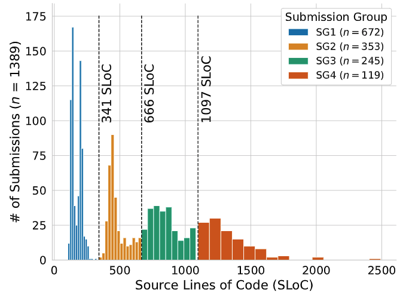
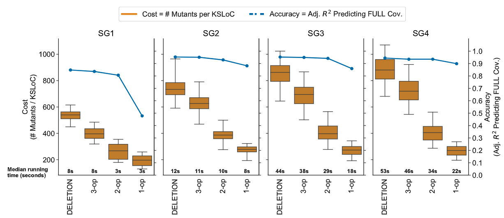
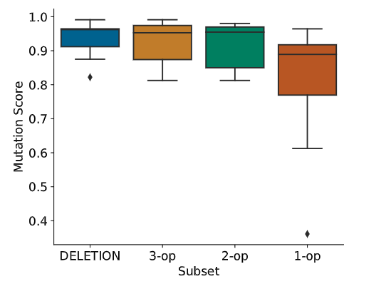
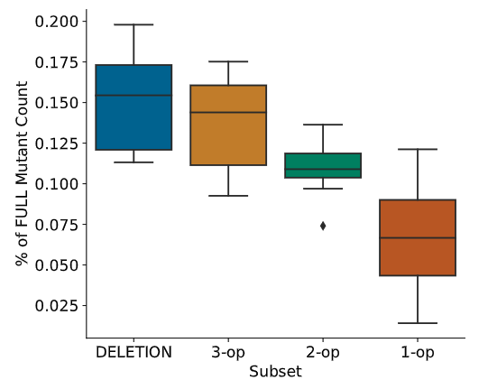

<small>
_This post originally appeared on [my Medium blog](https://ayaankazerouni.medium.com) on March 17, 2021._
</small>

This is an overview of the paper *[Fast and Accurate Incremental Feedback for Students’ Software Tests Using Selective Mutation Analysis](https://www.sciencedirect.com/science/article/pii/S0164121221000029)*, published in the Journal of Systems and Software. The paper is freely available. My co-authors were [Jamie Davis](https://davisjam.github.io), [Arinjoy Basak](https://arinjoy-basak.github.io/), [Cliff Shaffer](https://people.cs.vt.edu/shaffer), [Francisco Servant](https://people.cs.vt.edu/fservant), and [Steve Edwards](https://people.cs.vt.edu/edwards).

TL;DR: Use the `RemoveConditionals` and arithmetic operator deletion (`AOD`) mutation operators for fast and reliable mutation analysis.

## Summary

Feedback about students’ software tests is often generated using code coverage criteria (like statement or condition coverage). These can be unreliable given that code coverage is satisfied simply by the execution of the code-under-test, and not by the actual assertions in the tests.

*Mutation analysis* is a stronger but much more costly criterion for measuring the adequacy of software tests. In this paper, we evaluated the feasibility of existing approaches to mutation analysis for producing automated feedback for student-written software tests. After finding that existing approaches were infeasible, we proposed new approaches for fast and accurate mutation analysis. Finally, we evaluated our proposed approaches for validity on an external dataset of open-source codebases, and report that our results may be generalisable beyond our educational context.

This post is of interest to Computer Science educators interested in giving students useful feedback about their software testing, and to software engineers interested in using mutation analysis to help them write stronger software tests.

## Background

Software testing is important. As it is increasingly incorporated into undergraduate programming courses, teachers are giving students feedback not only about the correctness of their programs, but also about the quality of their software tests.

Much of this feedback is based on assessments of test adequacy, most commonly *code coverage criteria*.

Code coverage criteria are satisfied when structural elements (statements, conditions, etc.) of a program are exercised by a test suite at least once. For example, under statement coverage, the test suite’s adequacy is measured as the percentage of program constructs that are executed by the tests. Code coverage is **fast to compute** and **amenable to incremental feedback**. But it can be **unreliable**, because the criterion is not bound to the *assertions* in software tests, just to the underlying code that is executed.

*[Mutation analysis](https://en.wikipedia.org/wiki/Mutation_testing)* is a far more reliable option. Small changes (*mutations*) are made to the target program, creating incorrect variants called *mutants*. The test suite is run against these mutants, and its adequacy is measured as the percentage of mutants that are detected by the test suite (i.e., by a failing test). The different kinds of mutations you could make are called *mutation operators*.

Mutation analysis subsumes code coverage as a test adequacy criterion[^1], and has been shown to be a **reliable measurement of test adequacy**. It can also be used to produce **incremental feedback**: I don’t need a student to have finished a project to give them feedback about their tests.

## Reducing the cost of mutation analysis
Unfortunately, mutation analysis can be **prohibitively expensive** computationally. The number of mutants produced for even a moderately sized project (~1 KLoC) can reach well into the thousands. Running the test suite for each of these mutants can take several minutes, sometimes hours.

Significant research effort has been devoted to reducing this cost. One such approach is *selective mutation*. The main idea behind selective mutation is to select a subset of mutation operators that give you the best “bang for your buck”. That is, out of the **Full** set of mutation operators (all available operators) you want a subset that gives you a reliable test adequacy score — one that is close to the “true” thoroughness of your tests — while producing a small number of mutants.

Numerous such operator subsets have been proposed. One key example is the **Deletion** set, originally proposed by Roland Untch[^2] and reified by Jeff Offutt and colleagues[^3].

Deletion operators create mutants by systematically deleting program constructs. This simple mutation scheme results in significantly fewer mutants. For example, if we were to remove the arithmetic operator in the expression `a + b`, we just create two mutants: `a` and `b`. This is in contrast to the four mutants that would be created by arithmetic operator **replacement**: `a — b, a / b, a * b, a % b`.

We used the mutation analysis system [PIT](https://pitest.org), which is built for speed and scalability. We approximated the Deletion set in PIT to be:

* **RemoveConditionals**, which replaces conditional statements with boolean literals, i.e., `true` (forcing the execution of the “if” branch) or `false` (forcing execution of the “else” branch)
* **Arithmetic operator deletion (AOD)**. E.g., the expression `a + b` would produce the mutants `a` and `b`, removing the arithmetic operator (and one operand) entirely.
* **NonVoidMethodCalls**, which replaces calls to non-void methods with the default values for the specific return type. That is, `int`-returning method calls would be replaced with 0, `Object`-returning method calls would be replaced with `null`, etc.
* **VoidMethodCalls**, which simply removes calls to methods that do not return anything.
* **MemberVariable**, which removes assignments to instance variables.
* **ConstructorCalls**, which replaces calls to constructors with `null`.
 
## Fast and accurate mutation-based feedback

Students in our courses are allowed and encouraged to make many incremental submissions to the auto-grader to help them ensure they’re on the right track. As deadlines approach, this can result in bursty traffic placing enormous load on the server.

We ran mutation analysis on 1389 submissions in two courses in the CS program at Virginia Tech: a second year course on Software Design and Data Structures, and a third-year course on Data Structures and Algorithms. Projects were implemented in Java, and students were required to turn in [JUnit](https://junit.org) test suites with their project submissions.

Analysis was conducted on a machine with similar specifications as the one serving our auto-grading infrastructure, [Web-CAT](https://web-cat.github.io). We did not eliminate *equivalent mutants* from our data-set. These cannot be automatically identified, which makes eliminating them from our corpus a daunting prospect.

We grouped submissions by source lines of code (SLoC), ranging from ~150 LoC to ~1200 LoC.

<figure>
  
  <figcaption>Groups of submissions based on source lines of code (SLoC). Dashed lines indicate group boundaries.</figcaption>
</figure>

For each operator subset, we looked at
* **Computational cost:** the running time in seconds (i.e., how long would a student spend twiddling their thumbs waiting for feedback?) and the number of mutants produced per thousand lines of code
* **Accuracy** at predicting coverage under the Full set. That is, if mutants under a given subset are killed by the test suite, how likely is it that the test suite will also kill mutants under the Full set?
 
Preliminary results showed that comprehensive mutation (i.e., using all available mutation operators) was certainly too slow for our purposes. For submissions in the larger submissions groups, even the Deletion set took too long (nearly a minute) to produce feedback.

That said, the Deletion set showed promise. As Offutt and friends reported, it produces a remarkably good approximation of mutation adequacy at a fraction of the computational cost of comprehensive mutation.

Can we reduce this cost further?

## Reducing the cost of the Deletion set
*Do we need all six Deletion operators to make a useful approximation of mutation adequacy?*

We used forward selection to determine an appropriate ordering of Deletion operators, set up as follows:

* **Dependent variable:** Mutation coverage using all available operators
* **Independent variables:** Mutation coverage under each individual Deletion operator
* **Procedure:** Starting from an empty set of operators, we iteratively added the single operator that most improved a model predicting comprehensive mutation coverage, stopping when all Deletion operators were included or when the model could no longer improve.
 
All Deletion operators were included, in the following order: `RemoveConditionals, AOD, NonVoidMethodCalls, VoidMethodCalls, MemberVariable, ConstructorCalls`

Then, we examined the cost and effectiveness of incremental slices of this ordering:

* **1-operator subset**, containing only `RemoveConditionals`
* **2-operator subset**, containing `RemoveConditionals` and `AOD`
* **3-operator subset**, containing `RemoveConditionals`, `AOD`, and `NonVoidMethodCalls`
* …continued until the entire Deletion set is included
 
## Result
We found that most of the Deletion set’s effectiveness comes from the first two operators, i.e., `RemoveConditionals` and `AOD`. Inclusion of additional operators drives up the cost, but with little improvement to accuracy.

<figure>
  
  <figcaption>The cost and accuracy of our proposed incremental subsets of operators. For each subplot, the left axis represents cost (# mutants per KSLoC) and the right axis represents accuracy (Adjusted R2 predicting Full coverage) Y-axes are shared across subplots. Inline text at the bottom of the charts indicates the median running time on our server.</figcaption>
</figure>

In the figure above,
* Each column represents a single submission group,
* Each box plot represents the cost distribution of a subset for that submission group, in mutations-per-thousand-LoC,
* Each blue dot represents the percent of variance in comprehensive mutation that is explained by that subset for the given submission group
 
We can see that for submission groups 2–4, the cost drops precipitously from Deletion &rarr; 3-op &rarr; 2-op &rarr; 1-op, while the accuracy stays more or less the same. For the smaller submissions in group 1, it’s possible that they simply do not provide enough opportunities for mutation to take place, so accuracy takes a huge hit for each mutation operator that is excluded.

Some key takeaways:

**The RemoveConditionals operator, by itself, is enormously effective** for the larger, more complex submissions, pushing 90% adjusted R2 for group 4 submissions (see the 1-op box plot in the rightmost subplot). For groups 2 and 3, it still does pretty well, but requires the inclusion of `AOD` operator to cross the 90% threshold.

**Which operators are most useful seems tied to the project itself.** It is no surprise that `RemoveConditionals` does not do so well for the group 1 submissions: they are of minimal cyclomatic complexity, meaning they contain few conditional statements. Including `AOD` substantially improves the approximation, because these projects tend to focus more on arithmetic operations and less on data structure implementations (in contrast to the submissions found in the Data Structures and Algorithms course).

## Validating our results
At this point, it looks like mutation analysis using `RemoveConditionals` or `RemoveConditionals+AOD` are feasible options for giving our students fast and reliable feedback about their test suites.

The question now is: are these results generally useful? Or are they specific to submissions produced by students in our courses?

We turn to a data-set[^4] released by Marinos Kintis and colleagues containing programs, mutants, and mutation-adequate test suites, drawn from 6 open-source Java projects.

Using this dataset, we evaluated the cost and effectiveness of the Deletion, 3-op, 2-op, and 1-op subsets.

For each subset, we examined:
* **Reliability**, measured by creating a subset-adequate test suite, and seeing how it held up using all possible mutants. In other words, if a developer stopped testing when they satisfied a subset, how thorough would their test suite be under comprehensive mutation?
* **Cost**, measured as the percentage of all possible mutants that were created by the subset.
 
Kintis et al. also hand-marked equivalent mutants in their published data-set. This gives us an opportunity to test our operator subsets in the absence of these mutants, addressing a limitation present in our analysis of our students’ submissions.

## Result
Results were largely in agreement with the study described above.

In terms of **reliability**, it appeared that the incremental subsets were nearly as effective as the entire Deletion set, with the 3-op subset (`NonVoidMethodCalls` and beyond) bringing diminishing returns. This is similar to our original results.

The **cost** naturally decreases in the order Deletion &rarr; 3-op &rarr; 2-op &rarr; 1-op.

<figure>
  
  <figcaption>Mutation coverage: Proportion of Full mutants detected by the subset-adequate test suite.</figcaption>
</figure>
<figure>
  
  <figcaption>Computational cost: Number of mutants produced by each subset, expressed as a proportion of the Full number of mutants.</figcaption>
</figure>

## Final remarks
These results suggest that the `RemoveConditionals` operator is a feasible option for fast and accurate mutation analysis. And this makes sense, because `RemoveConditionals` can be thought of as a stronger form of condition coverage&mdash;only instead of simply requiring that all conditions evaluate to true and false at least once, it is satisfied when the tests depend on the conditions evaluating to true or false at least once. The difference is subtle, but results in much more thorough tests when used as a basis for measuring test adequacy.

Including the `AOD` operator provides an even stronger criterion, and it especially useful when the code-under-test has few logical branches. Including further Deletion operators drives up the cost but without improvements in effectiveness.

It remains to be seen whether mutation-based testing feedback using one or both of these operators helps students to produce stronger test suites. Future work should involve evaluating mutation analysis for its utility as a device for practice and feedback with software testing.

---

[^1]: [Offutt, 1996](https://cs.gmu.edu/media/techreports/ISSE-TR-96-01.pdf)
[^2]: [Untch, 2009](https://dl.acm.org/doi/10.1145/1566445.1566540)
[^3]: [Delamaro, Offutt, & Ammann, 2014](https://ieeexplore.ieee.org/document/6823861)
[^4]: [Kintis et al., 2016](http://pages.cs.aueb.gr/~kintism/papers/scam2016/)
