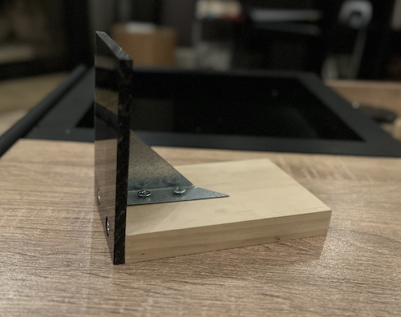

*I signed up for a short machine shop training, and was reminded what it's like to do something for the first time and struggle with it. In related news, I am teaching intro programming again in the Fall.*

A couple of weeks ago some colleagues and I signed up for the Cal Poly College of Engineering [Red Tag Tour](https://ceng.calpoly.edu/connection/2019/09/red-tag-training-2/) and earned our "red tags".
These are passes that allow us to use the wood and sheet metal shop on the Cal Poly campus.
It was a 3-hour session that started with a whirlwind introduction to the machine shop in the Aero Hangar on campus, following which we worked through a scaffolded sequence of steps to make our own bookends.
Here's mine:

<figure>

<figcaption>
Not just my best handiwork, but also my only handiwork.
</figcaption>
</figure>

It was a blast! I think it's super cool that this is offered on our campus, and that they had a day where faculty could attend.
And I'm super grateful to the two student volunteers who were extremely patient with us.
What I do with my cool new red tag pass remains to be seen.

Anyway, we used a number of tools to make our bookends:

* A compound slide to cut a piece of acrylic
* A few different drill presses
* A miter saw to cut a length of wood
* A step shear to cut a sheet of metal (by far the most fun tool to use)
* A rotex punch to punch holes in the metal
* A corner shear to cut a 90&deg; corner off the metal
* A finger brake to bend the sheet metal

It was a nicely-designed activity meant to introduce us to the types of tools that are available in a typical machine shop and what they do.

I had never set foot in a machine shop before, so this was all new to me. And boy was I bad at it.

By that I mean there were many steps with which I struggled in many little ways; ways that I didn't expect while watching the student volunteer demonstrate the steps beforehand.
For example:

* While cutting the acrylic piece, I stopped pushing the acrylic through the saw when I felt the resistance reduce. But I had only cut through 3/4 of the acrylic, and didn't immediately see this from my line of sight. This was easy to fix, but resulted in a cut that was not super smooth.
* While countersinking the holes I drilled in my acrylic piece, I first drilled too little, and then over-corrected and ended up with comically large rims (far bigger than the heads of the screws that eventually went in).
* While punching holes in the sheet metal, I didn't do so in a smooth motion and ended up with holes that were jagged on the other side. Thanks to the student volunteer who hammered away at them to flatten them out!

It's been a while since I did something _totally, completely_ new to me.
It felt good to be that far from familiar territory!
First, I promptly forgot a fair bit about all the tools to which I was introduced.
Then, after watching the student volunteer demonstrate the steps to build the bookend, I thought "okay, looks fine, I can do that".
Finally, I proceeded to struggle in a bunch of little ways that neither they nor I expected.

**The experience has made me a bit more empathetic toward students in my introductory programming courses.**
For example, the students in my CS 0 class have often never programmed before I see them, and they are doing something _totally, completely_ new to them.

A really reductive description of my intro course might be that I introduce students to a bunch of "tools" (~~drill presses, step shear, miter saw~~ control flow, functions, test cases) and give them scaffolded practice tasks (~~making a bookend~~ making data visualisations).
They then proceed to work on their bookends, and while doing so struggle in little ways that neither they nor I expected.

It's hard to do things for the first time!

It's also worth remembering that I don't have any personal investment in being good at wood- or metal-working, so I was comfortable asking for help when I needed it, and was okay with taking a bit more time to make my bookend if I needed to.

**This is usually not so for first-year CS students.**
At Cal Poly we have a "competitive enrolment policy", i.e., students are admitted directly into the CS major, or need to jump through some GPA hoops to transfer into the CS major.
This can be a bad thing,[^competitive-enrolment-policy] in part because it results in students already having a bunch of perceived self-worth wrapped up in being good at computer science, which can get in the way of their learning.

Anyway, I'm grateful to the Red Tag training for (1) existing, and (2) reminding me what it's like to be a student doing something for the first time.
I will try to remember the feeling during Q&A sessions and office hours.

---

[^competitive-enrolment-policy]: Nguyen & Lewis. _[Competitive Enrollment Policies in Computing Departments Negatively Predict First-Year Students’ Sense of Belonging, Self-Efficacy, and Perception of Department](https://par.nsf.gov/servlets/purl/10195776)_
