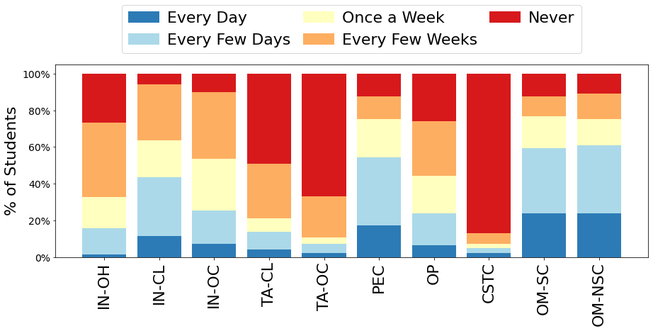

<small>
_This article was originally posted on [my Medium blog](https://ayaankazerouni.medium.com) on November 13, 2021._
</small>

This is an overview of the paper _[Patterns of Academic Help-Seeking in Undergraduate Computing Students]({{site.baseurl}}/publications#koli2021help-seeking)_, appearing at the 2021 [Koli Calling](https://www.kolicalling.fi/) conference on computing education research. It was written by my student collaborator Augie Doebling and myself.

Help-seeking is an expected phase in learning or problem-solving. The process involves a fair bit of self-regulatory skill; a learner must recognise that a problem or difficulty exists, assess whether they need help to surmount it, identify a help resource, and finally seek and process help.

Undergraduate students tend to have a variety of academic help resources at their disposal. For example, taking Cal Poly as a typical example, students can seek help with their coursework from online sources, their peers, instructors, or the departmental peer tutoring centre.

Much has been written about how students use individual resources, such as [TA office hours](https://dl.acm.org/doi/10.1145/3291279.3339418) or [Piazza](https://dl.acm.org/doi/10.1145/3017680.3017745). But what we know holistically about how computing students navigate this array of resources is largely anecdotal. What resources do they tend to use most frequently? Does this differ for different demographic groups? What influences students to approach or avoid certain resources?

We conducted a mixed-methods study to better understand the help-seeking behaviours of students in the CSSE department at Cal Poly.

* **Survey:** Distributed in a wide variety of Cal Poly CS courses, asking students about the frequency with which they accessed various help resources.
* **Interviews:** A series of one-on-one interviews with students to learn the factors that influence their help-seeking decisions.

We discussed the following resources (acronyms are for the figure that follows):

* The instructor&mdash;in office hours (IN-OH), in class (IN-CL), or online (IN-OC)
* The TA&mdash;in class (TA-CL) or online (TA-OC)
* Peers&mdash;enrolled in the same class (PEC) or other classes (OP)
* The peer tutoring centre (CSTC)
* Online materials&mdash;specific to the course (OM-SC) or not specific to the course (OM-NSC)

## Frequency of help-seeking

We received 138 survey responses about the frequency with which students accessed various help resources.

<figure>
  
  <figcaption>
  Frequency of accessing various help resources.
  </figcaption>
</figure>

Students most frequently relied on **online sources**, followed closely by their **peers in class**.
They reported modest reliance on the **instructor** for help, preferring to ask questions in class or online rather than going to office hours.

Students did not report much use of **course TAs** or the **peer tutoring centre**.
The former may be because TAs at Cal Poly do not hold office hours like they might at other universities&mdash;there is typically much more contact with instructors than with TAs.

## Trends by student demographics

There was no difference in the overall frequency of help-seeking (across all resources) between men and women.
However, women reported turning to the "social" help resources more often than men did: they attended instructor office hours and accepted help from peers roughly _Once a Week_ compared to men’s _Every Few Weeks_.

**Why might this be?** [Previous research](https://bera-journals.onlinelibrary.wiley.com/doi/10.1002/rev3.3196) has suggested that women tend to have a better attitude toward help-seeking than men do, viewing it more as a learning strategy and less as a sign of dependence.
It’s possible that students who are less inclined to seek help from social sources perceive some level of threat to their self-esteem from the act of seeking help.

Finally, computing majors reported relying on their peers and online sources more often than did non-computing majors. No other notable patterns were observed for other resources and demographic groups (e.g., ethnicity, prior experience with computing, or academic progress).

## What makes students approach or avoid help resources?

Having discovered trends and correlations regarding frequency of accessing help resources, we turned to interviews to understand why students make the help-seeking decisions that they do.

We asked students about the primary resources they turn to for academic help, the resources that they tend to avoid, and their reasons for both. A number of themes emerged from our qualitative analysis of interview transcripts.

First, students tended to progress from informal to formal sources of help: a frequently reported pattern was the progression from *online sources* to *peers* to *instructors*, where students only progressed to the next resource if the previous resource did not help surmount a problem.

Below, I describe students’ reasons for using or not using different sources of academic help.

### Online sources

Reasons for using:

* *Ease of access:* Just a few button presses away.
* *Concrete examples:* Sites like StackOverflow were reported as being useful when one is trying to “get the ball rolling” with a new language or API, but less useful for obtaining concept knowledge about a topic.
 
Reasons for not using:

* *Low signal-to-noise ratio:* It takes experience and expertise to sort through the wealth of information available through a simple Google search. Students reported that online resources became more useful to them as they became more experienced programmers, but were overwhelming when they were first learning programming.

Interestingly, some students did not report online sources in their help-seeking process until specifically asked about them; they did not view it as seeking help, but rather viewed it as helping themselves.

### Peers

Reasons for using:

* *Ease of access:* Peers are just a text message away.
* *Stress-free help:* Peers tend to not judge one’s lack of knowledge. There is less (perceived or actual) “threat” from seeking help from a peer than there is from, say, course staff.

Reasons for not using:

* *Lack of a peer network:* First-year students, transfer students, or students from historically minoritised groups may not have access to a solid network of peers.
* *Fear of academic dishonesty:* Students worried about accidentally breaking rules related to academic dishonesty if they worked too closely with peers. For example, they reported being hesitant to speak in detail about (or ask others about) their programming projects.

### Instructors

Reasons for using:

* *Depth of content knowledge:* Instructors are knowledgeable about their subject matter, and often provide the definitive help needed to surmount a problem.
* *Depth of pedagogical content knowledge:* Instructors have seen many of the common bugs, pitfalls, and strategies used for their assignments, and are best suited to help when a student is struggling.
* *Forming a connection:* Synchronous office hours helped some students form connections with their instructors, making help-seeking and learning a stress-free experience.

Reasons for not using:

* *Tacit knowledge:* Instructors often have an “expert blind spot”, and the help they give often assumes knowledge that the student (1) doesn’t have, or (2) can’t automatically transfer to their current problem.
* *Approachability:* Students reported that instructors could often be intimidating (or worse, demeaning) when they were asked for help. Importantly, many students reported that poor experiences with one instructor made them less likely to seek help from any instructors in the future.

## Recommendations for CS instructors or departments

Based on students’ responses, we close with some recommendations for reducing the barriers to seeking academic help.

* **Online sources**&mdash;In early courses, model a process for finding information online and identifying high-quality sources. This need not be limited to StackOverflow answers; it can also include official documentation for programming languages or APIs.
* **Peers**&mdash;Feature collaborative work more prominently in early courses. This could include team projects as well as teaching practices like peer instruction or think-pair-share. Featuring more collaborative work in earlier courses would provide students access to peers to work with “legally”, and would help them form peer networks that could last into future courses.
* **Instructors**&mdash;Ensure that classrooms and office hours are welcoming spaces. Instructors play a massive role in shaping the overall climate of a classroom or department. Being cognizant of this outsized impact and taking steps to ensure a welcoming atmosphere could have huge positive implications for student success.

---
