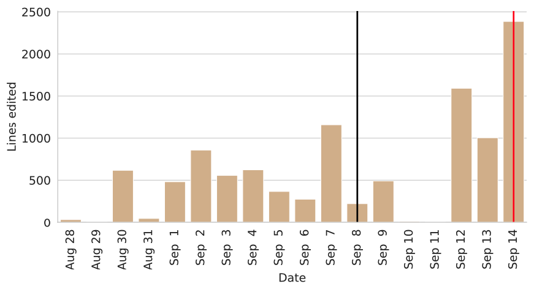
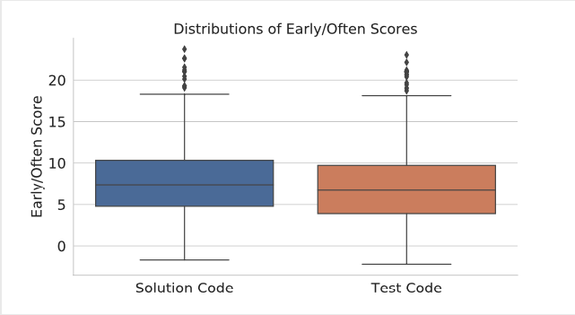
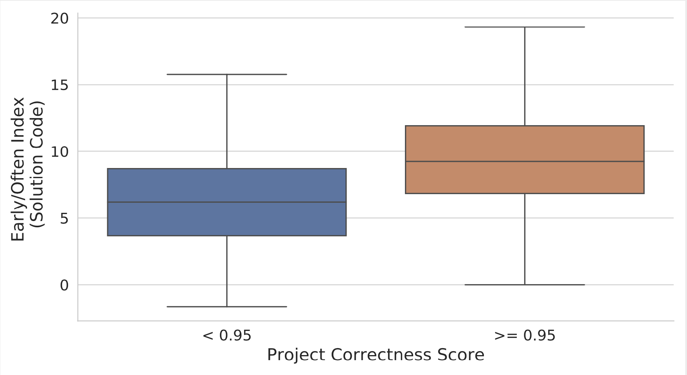
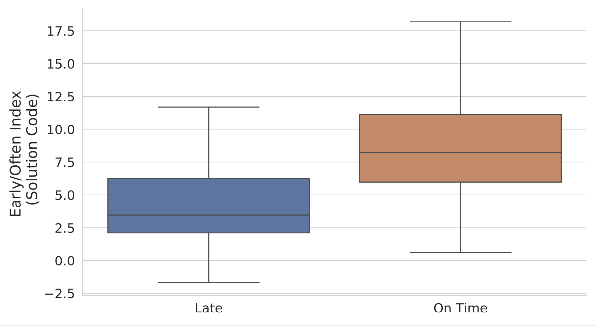

<small>
_This article originally appeared on [my Medium blog](https://ayaankazerouni.medium.com) on April 17, 2020._
</small>

*This is a brief overview of the following research papers by myself, [Steve Edwards](https://people.cs.vt.edu/~edwards/), and [Cliff Shaffer](https://people.cs.vt.edu/~shaffer/):*

* *__[DevEventTracker: Tracking Development Events to Assess Incremental Development and Procrastination]({{ '/publications/iticse2017paper' | absolute_url }})__* (with T. Simin Hall), published at ITiCSE 2017, and
* *__[Quantifying Incremental Development Practices and Their Relationship to Procrastination]({{ '/publications/icer2017paper' | absolute_url }})__*, published at ICER 2017

I am summarising these papers together because they are closely related.

## Summary

We would like to determine the effectiveness of the time management practices displayed by students as they work on large and complex programming projects for the first time. We used qualitative data (obtained from interviews with students) and quantitative data (obtained using IDE logging infrastructure) to characterise their software development habits, and we analysed their relationships with project outcomes like correctness, total time taken, and the project’s early or late status.

When students worked earlier and more often, they produced projects that:
* were more correct,
* were completed earlier,
* took no more or less time to complete
 
So working earlier and more often doesn’t seem to be giving the student more time to complete projects, just more *constructive* time.

## Motivation

Software development is a skill. Like any skill, it requires practice and feedback in order to develop. Ideally, this feedback should formative — delivered as students work on projects. However, in education contexts, assessments of software projects are driven by “after-the-fact” qualities like correctness, code coverage, code style, etc. In the papers listed above, my co-authors and I present methods to characterise students’ time management habits as they work on large and complex projects. The goal is to use this information to formulate formative feedback about their development practices.

## Observing the development process

To properly assess a ~30-hour programming process, we need to be able to observe it. We developed an Eclipse plugin that emits events for various in-IDE actions, including:
* executions
* compilations
* file saves
* line-level edits
 
We use these data to capture, characterise, and determine the effectiveness of the software development process undertaken by students. This process involved ingesting a large (ish) volume of data and turning it into an objective measurement of some aspect of the programming process (in this case, procrastination).

## When do students work on software projects?

We set out to quantitatively measure the extent to which **procrastination** manifests as students work on software projects. We look at the work done by students as a distribution of work days, from the first day the student worked on the project until the last day, typically the day of the project deadline. The value for each work day is the amount of observable “work” that was put in on the project — the number of character code edits. The mean of this distribution gives us the “average day” on which students tended to work on the project. If we measure this in terms of *days until the deadline*, then a higher number indicates that more work was done earlier, and a lower number indicates that more work was done closer to the deadline.

As an example, consider the figure below, which shows how a real student distributed their work across the days on which they worked on a project.

<figure>

<figcaption>
  The mean edit time for a student, drawn from real data.
</figcaption>
</figure>

<!-- A bar chart showing the amount of work put in by a student on each day from August 28 to September 14. -->
The red line on September 14 indicates the project deadline, and the black line on September 8 indicates the student’s “mean edit time”, which is 6 days before the deadline. A sizeable portion of work was done within the period of September 1 to September 8, and daily work was much higher during the last three days of the project lifecycle. This leads the mean edit time to be roughly in the middle of those time periods. The student’s score is therefore sensitive to not only the days on which was done, but also to the amount of work that was done on those days. Since this is simply a mean edit time, we can measure this with solution code, test code, or both.

We might also have measured the median edit time (i.e., on what day was half the work done on a project?). However, we opted for the mean since it is more sensitive to outliers, which are important when measuring procrastination (e.g., large amounts of code being written toward the end of a project timeline).

The figure below indicates distributions of the mean edit time for solution code and for test code, across all project implementations.

<figure>

<figcaption>
On average, students tended to write code fewer than 10 days before the project deadline.
</figcaption>
</figure>

<!-- On average, students tended to write code fewer than 10 days before the project deadline. -->
This figure tells us that students tended to work rather close to the deadline, even though they were given about 30 days to work on projects. Similar distributions of mean times were observed for solution code ($$\mu=8.48, \sigma=6.44$$), test code ($$\mu=7.78, \sigma=7.04$$), program executions ($$\mu=8.86, \sigma=8.82$$), and test executions ($$\mu=7.09, \sigma=7.10$$). Test editing and launching tends to occur slightly closer to the project deadline, but this difference appears to be negligible.

## How valid is our measurement?

The measurement described above is simple enough: it’s just a mean. Still, it is worth investigating whether it measures what we think it measures, i.e., the extent to which procrastination manifests on a software project. There is no readily-available “ground truth” against which one can test such a measurement. Therefore, we interviewed students in depth about their development experiences on two such assignments, and compared their responses with our measurements. Interviewees were given our measurements at the end of the interview, and we determined if they matched students’ expectations.

In general, students felt that our measurements were accurate. Additionally, students believed that feedback driven by a measure such as this could help them stay on track on future programming projects. They stated unconditionally that they would make more of an effort to improve their programming practice if they were given feedback about their process between assignments.

## Can this measurement explain differences in project outcomes?

A primary thesis of these papers was that different software development habits can explain differences in software project outcomes for intermediate-to-advanced student software developers. With our measures and their qualitative evaluations in hand, we set out to quantitatively examine their relationships with the following project outcomes:
* **Project correctness**, measured as the percentage of instructor-written reference tests passed,
* **Time of completion**, measured as the number of hours before the deadline the project was completed, and
* **Total time spent**, measured by adding up the lengths of all work sessions spent on the project

We used within-subjects comparisons to make inferences, allowing us to control for traits unique to individual students. Different students’ behaviours *and* outcomes could be symptoms of some other unknown factor (e.g., differing course loads or prior experience), making such inferences weaker. To test for relationships with the outcome variables, we used an ANCOVA with repeated measures for each student. Students were subjects, and assignments served as repeated measures (with unequal variances), allowing within-subjects comparisons. In other words, each student’s software development habits were measured repeatedly (assignments), and differences in outcomes for the same student were analysed.

Results are summarised below.

**When students worked earlier and more often, they tended to produce programs with higher correctness.** To illustrate this, we split the dataset roughly into half: those projects that had “solved” the assigned problem (53%), and those that had not (47%). The figure below shows the difference in edit mean times between these populations.

<figure>

<figcaption>
  Comparison of solution edit times between projects that correctly solved an assignment, and those that did not.
</figcaption>
</figure>

**When students worked earlier and more often, they tended to finish their projects earlier.** This is so intuitive, it’s almost tautological. It is encouraging that the measurement is able to discriminate between early and late project submissions.

<figure>
  
  <figcaption>
  Comparison of solution edit times between on-time and late submissions.
  </figcaption>
</figure>

Finally, **there was no relationship between total amount of time spent on the project and the solution edit mean time.**

## Final Remarks

The important takeaway from these papers is not the revelation that _procrastination = bad_. It is that we can reliably identify when procrastination is taking place on software projects. If we can do this during a project timeline, i.e., while the student is working on it, we may be able to intervene and help them adjust their programming behaviours before they face the consequences of procrastination.

---
