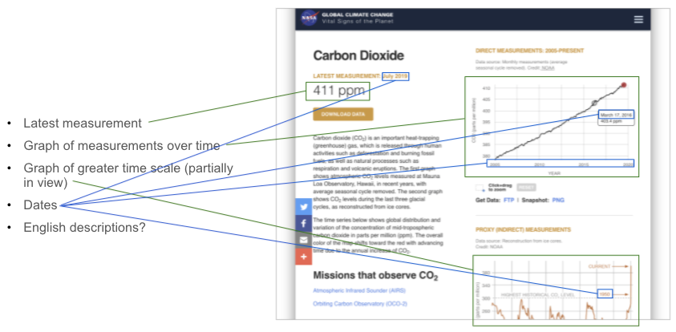

One view of computation (or computing) is the *processing of data to create other data*.
This act of transforming data suggests that there are *operations* that can be done on data.
In perhaps the most familiar case, two numbers can be added together to get another number.

Specifying and developing a computation can be—and often is—approached from a data-centric view.
That is, we identify what kind of data we're working with, and that dictates the operations that are available (i.e., the things we can do with that sort of data).
We'll emphasize this perspective throughout this course.

So: we'll begin this introduction to computing just like we begin consideration for problems that we aim to solve with computing: by thinking about data.

**But what is data?** As we go about our daily lives, we constantly encounter and interact with data.
Such data takes a great variety of forms and is not always or necessarily linked to computing.
Some of the most ubiquitous data with which most of us interact are

- words from another person,
- the people and objects that we see around us,
- the physical items that we pick up and use.

<!-- These kinds of data my not match what one commonly thinks of when using the word "data", likely because humans are accustomed to processing such data frequently and rapidly (still better than computers in most cases). -->

But what sort of data is presented to us when we visit a website or when we use a mobile app?
More generally, what sort of data does a computer manipulate?
Sounds, colors, and textures?
Or is it just numbers such as measurements and the results of calculations?

## Different perspectives on data

**Is text data?** 

Consider the "text" of the article below.

{% include image.html 
url="is-text-data.png"
width="60%"
alt="Screenshot of an article about carbon emissions. The screenshot contains a graph showing carbon dioxide emissions over time and prose describing the graph."
%}

The main body of text consists of two *paragraphs,* each made up of *sentences* constructed *from words.*
Each word consists of *individual characters.*
This allows for one to consider text at various levels of specification: body > paragraph > sentence > word > character.

{:.callout .ponder}
Could we then consider the entire "text" of the article to simply be a bunch of characters? Yes. But is this a useful perspective? Sometimes it is.

Often, however, we may want to consider (and work with) data from a variety of perspectives.
If, for instance, we wanted a computation that considers each paragraph on a webpage, then a perspective of the text as a sequence of characters is likely more detailed than desired.
This is similar to an experienced reader reading a book in chunks of words or phrases instead of individual characters.

This is a matter of **abstraction**. It is common to ignore (abstract away) details of data until those details are needed.

{:.callout}
The perspective you take when considering data influences and is influenced by the specific computational task you are aiming to perform.

### One Perspective

What "data" do you see in the article above?

<!--  -->

One perspective might be to focus on the data presented as the content of the article (i.e., the data presented in the line chart).
Such data includes measures of carbon dioxide, years, and points labeled with a date and the specific measurement on that date.

### Another Perspective

A different perspective we might take is that, in addition to the measurements described in the article, the article also includes the following bits of data:

- Text: The written content of the article, including all the words and sentences.
- Images: Any visual content, such as photographs or diagrams.
- Links: Hyperlinks to other articles or resources.
- Interactive graph: The Direct Measurements graph that users can interact with.

These data are interpreted by the browser (Chrome or Firefox or Arc, etc.) and used to display the webpage to you, the user.
This perspective is almost entirely detached from the data within the content of the article, i.e., the meaning or implications of the carbon dioxide measurements.

{% include image.html 
url="data-article.png"
width="100%"
alt="Screenshot of an article about carbon emissions. The screenshot contains a graph showing carbon dioxide emissions over time and prose describing the graph. There is also a listing of the different bits of data shown in the screenshot."
%}

---
