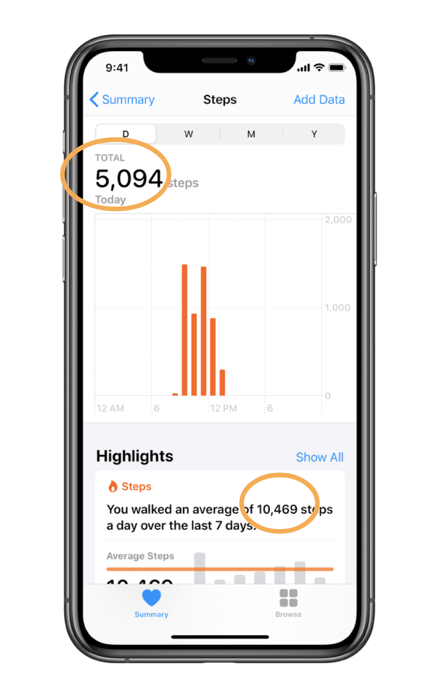

Lets dive into some of the computational aspects of "data" with a type of data we are familiar with manipulating: **numbers**.
We're going to draw on what we already know about algebra to build up our understanding of using this type of data in computing.

Consider the screenshots below of a Health app or the Instagram app on a mobile phone.

<figure style='display: flex; align-items: center; justify-content: center; flex-wrap: wrap;'>


  <figcaption>
  How are numbers being used in these displays? What information are they representing?
</figcaption>
</figure>

## Data and operations

When we are talking about numbers from a computer science perspective, we want to think carefully about them in terms of the operations that are allowed and expected on numbers.
For example, in computer science, we differentiate between **Integers** (whole numbers) and **Floating point numbers** (numbers with a fractional component).

Integers are used for values such as: Year, Page Number, Number of Friends

* Year: 2020
* Page: 327
* 421 Friends

Floating point numbers are used for values such as: Approximation of real numbers, Mass, Distance, Temperature

* 18.4 kg
* 27.4 miles
* -3.7 ºF

Some of the common operations associated with numbers are addition, subtraction, multiplication and division

For example: `Year 2020 plus 3 years => 2020 + 3 = 2023`

Other operations include rounding a floating point number to the nearest whole number.

For example: `87.6 degrees rounded up to 88 degrees`

## What is an expression? 

Let's establish some terminology to describe how we understand the results of a computation.

**Evaluation** is the process of applying computations to data to arrive at a value.
An **Expression** is anything that can be evaluated.

You've seen math expressions before, so let's start there.
If these look simple, great, let's just make sure we are on the same page:

What is the result of this expression?

```ts
(17 + 2)
```

And this one?

```ts
(5 * 6)
```

And this one?

```ts
((7 + 4) * 2)
```

Finally, what about this one?

```ts
4 * 2 * 5 + 12 / 6 - 2
```

<!-- 40 -->

How did you approach evaluating the expression above?

You likely recall that in mathematics there are conventions on *order of operations*.
This idea is present in programming as well.
An expression written in a program will be evaluated one operator at a time, following established rules about the order in which to apply operators.

Similar to mathematics, we can also force a specific precedence (or order) by using parentheses `()`.

Consider the same expression as before, but now we use parentheses to denote the individual *sub-expressions* that are being evaluated step-by-step.

```ts
((((4 * 2) * 5) + (12 / 6)) - 2)
```

This expression is composed of smaller (and smaller) expressions.
The smaller expressions must be evaluated before one can evaluate the larger expression.

So:

* A value cannot be evaluated any further.
* An expression can be:
  - A value, or
  - An operation acting upon a value or an expression (for example, `5 + 10` or `(7 + (4 * 2))`)

(We will expand on this as we progress further.)

Now lets look at another expression:

<style>
.expr { text-decoration-line: underline; text-decoration-thickness: 2px; }
.l1 { text-decoration-color: #e63946; text-underline-offset: 4px; }   /* 7 */
.l2 { text-decoration-color: #2a9d8f; text-underline-offset: 12px; }   /* (7 + 4) */
.l3 { text-decoration-color: #9341dbff; text-underline-offset: 20px; }  /* ((7 + 4) * 2) */
</style>

<p style='text-align: center; font-size: 2em'>
  <span class="expr l3">(
    <span class="expr l1">2</span> *
    <span class="expr l2">( <span class="expr l1">7</span> + <span class="expr l1">4</span> )</span>
  )</span>
</p>

Lets look at this with a diagram to help illustrate our mental model of evaluating this expression:

<pre class='mermaid'>
flowchart TD
  times --> plus
  times --> 2
  plus --> 7
  plus --> 4
</pre>

This representation is often called a "tree".
It is upside-down from what we usually think of a tree with branches expanding upwards.
If we start reading from the bottom we see numbers (values) and then operators joining numbers, and still more operators joining the results of the prior/lower expressions.
This allows us to read, bottom up, the order in which the evaluation will proceed.

So starting from the bottom we can read `"7+4"`, and then `"2*(7+4)"`.

Consider this expression tree as well:

<pre class="mermaid">
flowchart TD
  minus --> 16
  minus --> plus
  plus --> 3
  plus --> 2
</pre>

{:.callout .todo}
Can you re-write the tree above to a single-line valid expression?

## Steps of evaluation

To help make sure we are starting to build up our mental model for computation, lets take a moment to explicitly write down the evaluation of this expression into individual steps.

```ts
(16 - (3 + 2))
```

The steps of evaluation here are:

```ts
1. (16 - (3 + 2))
2. (16 - 5)
3. 11
```

### Another example

How about

```ts
((8 + 8) - (3 + 2))
```

What are the steps of evaluation for this expression?

You may notice that there are two options for potential starting points, since there's no obviously "smallest" expression to start with.
In cases like these, it's common convention to evaluate the left-most sub-expression first.

## Additional considerations

Although numbers and their operators are familiar, in computing, there are some additional considerations we need to talk about.

For example:

```ts
((3 + 3) / (3 - 3))
```

What is the result of evaluating this expression?

This is the first time we need to explicitly acknowledge that not all computations can be evaluated.
In fact, we need a way to represent ERRORS.
To be clear, lets consider the steps:

```ts
1. ((3 + 3) / (3 - 3))
2. (6 / (3 - 3))
3. (6 / 0)
4. !!!
```

There are different ways you can decide to represent this evaluation in your own mental model.
Some viable representations include a model in which you consider that the machine fails.
Some include the notion of "infinity", an imaginary but useful construct.

As another example of limits in computing, consider that in many programming languages, **integers have maximum and minimum values**.
For example, an 8-bit unsigned integer can only represent values from 0 to 255.[^binary]
Size limits in modern computing are much larger, but they do exist.
What happens when you go over or under these values?

[^binary]: **Why?** "8-bit" means there are 8 binary digits (bits) used to represent the number. In the binary system, each bit starts at 0 and can go up to 1 before overflowing to 0 and carrying 1 to the next digit (much like counting in the decimal [0-9] system, where 9 overflows to 0 and we carry 1 to the next digit). Counting this way, using 8 bits, we can represent a total of 2<sup>8</sup> = 256 different values.

Software errors can occur due to these _integer overflows_:

- Computing the average of two very large numbers might result in an overflow if the sum (but not the average) is greater than the maximum possible value.
- In the old Donkey Kong arcade game, the game calculated a timer for each level with the formula `10 * (level + 4)`. So for level 22, the timer would add up to 260. This was too large for the 8-bit counter's maximum allowed value. So the system overflowed to a very small number, making the level impossible to complete.
- More seriously, occasional integer overflows in the [Therac-25 radiation therapy machine](https://en.wikipedia.org/wiki/Therac-25#Root_causes) caused the machine to bypass some safety checks, causing at least six deaths as a result of radiation poisoning.

## Identifiers are also expressions

To further build up our mental model for more complex computation, consider how you would evaluate an expression that computes the area of a circle with radius `2`.

Or, more precisely, evaluate (&pi; * (2 * 2)).

How are we able to evaluate this? You likely have done something interesting in your mental model, which is to substitute a numeric value for the symbol &pi;.

* Identifiers (such as &pi;) can be bound to values.
* As a result, identifiers (or names) can be treated as expressions.
* Evaluation of an identifier gives the  **value** to which it was bound.

In other words, in the steps of our evaluation, at a certain point, we will substitute a value for any identifiers, something like:

* (&pi; * (2 * 2)) => 
* (&pi; * 4) => 
* **(3.14159 * 4) =>**
* 12.56636

Given this, we can extend our rules for expressions:

* A value cannot be evaluated any further.
* **An identifier is a name that refers to a value. Evaluation of an identifier gives its value.**
* An expression can be:
  - **An identifier or value**, or
  - An operation acting upon a value or an expression
* We'll fully parenthesize expressions before evaluating so there is no ambiguity.
* When evaluating an expression with a binary operation, evaluate the left sub-expression before the right sub-expression.

Building on this foundation, we can move on to reading and writing TypeScript programs.

---
