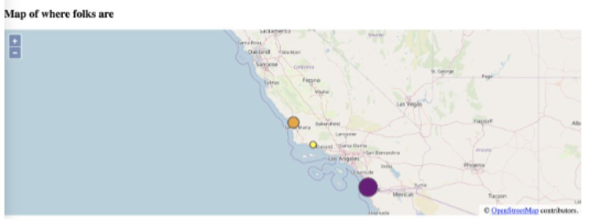

(Assignment originally created by [Dr. Zoë Wood](https://users.csc.calpoly.edu/~zwood).)

Computer science is a relatively new field and we are still figuring out how to teach it. In general, an important aspect of teaching is having an awareness/knowledge of the topic you are trying to teach.

Programming is something we all have engaged in, but we could all benefit from spending time considering the process of programming.  For this assignment, we will be completing a fairly simple program with an API that likely most are not familiar with (to level the playing field, and to put you in the shoes of students who may not be familiar with the programming language they are learning).

**Goal**: To examine our personal programming process.

**Process**: We will examine and document our personal coding process via the task of writing code to create an interactive map which shows where our classmates (in our small group) are in the world. We will accomplish this via writing code in javascript with calls to the [OpenLayers API](https://openlayers.org/). You may solve this problem by using the structure proposed in the Quick Start guide, i.e. not the "Build an Open Layers Application" instructions. Specifications for the programming aspects will be specified exactly below.

**Spirit of the problem**: Document your coding process in detail to help us explore and document the process of programming. Create a detailed list, including a list of times and activities taken to achieve the final goal. See the subset of my process anonymised as generalised activities so as not to not affect your process (yours should include the complete and exact list of the actual queries or tasks you completed!).

The programming specifications are as follows (intentionally general to allow you to explore your process):

* Create a webpage hosted in your own web space which draws an interactive world map using OpenLayers. The map should be centred on Cal Poly (but note that you can zoom out to accommodate a wide area).
* The map will include three different visual representations of icons used to represent where people enrolled in this class (and specifically in your “small” group) are currently (approximately) located.
* Identify people's location based on the ESPG:4326 location of the city they are currently residing in. You do not need to give one another your street address and may choose a closest big city if you feel more comfortable.
* The visual representations will vary based on the number of people in each area. For example, the below static image from my implementation has one person in Santa Barbara (represented by a smaller yellow icon), two people in San Luis Obispo (represented as a medium sized orange icon) and three or more people in San Diego (represented by a larger purple icon).
* You may choose a reasonable way to designate which style is associated with what number of people in that area. If your group does not have any regions with overlap, document your choice of what you will use visual style to represent and demonstrate the use of three different visual icon representations.
* You are free to choose if your code just supports a static set of locations (easier and allowed) or if you would like to generalise it to read in a list of locations.
* If you are feeling stuck, please do ping me and I can give you some hints but to start I’d like you to explore your process on your own. I will spare you one web wander and note that I found the following page useful: https://epsg.io/

**Core task**: Document your programming process in detail. Here is a sample of my process log. Please produce something similar but complete and with exact details (for example, anything labelled <task a> should have the actual feature of code you are testing) - include labels about failures and working steps, etc. Highlight key process elements. For example:

* Start 8:30
* Explore idea (waste time identifying correct API)
* Look for examples of code using identified API
* Distracted by detail of problem, looked at unrelated example implementations that sounded cool
* Try copy and pasting some example code - failed
* Look at developer view to see error
* Look for simpler example
* Copy and try again - It worked!
* Actually read the example code I got to work and think about what it is doing
* Get distracted by a detail I find interesting and think about it a bit
* Try changing example to accomplish <task a> - fail
* Try changing different part of example for <task b> - it works!
* Read documentation about <task a>, notice an error in my thinking, fix code - it works
* Create a back up of my code
* Make a major change for <task c> - fails
* Revert code to prior version
* Do more reading about API
* ....etc.... I am not listing all steps so as to not pollute your process - you should list all your steps! And what they were trying to accomplish and whether it worked or failed.
* 5 more steps and simple version of <task c> is complete—yay it worked!
* ~20 minutes messing around with <tack d> <Fill in for your exact steps - >
* ~20 minutes converting to code that generalises better for <task e>
* Done approximately 2 hours later

**Deliverable**: Turn in a PDF describing your process, that includes a link of where your solution is hosted and can be viewed.
