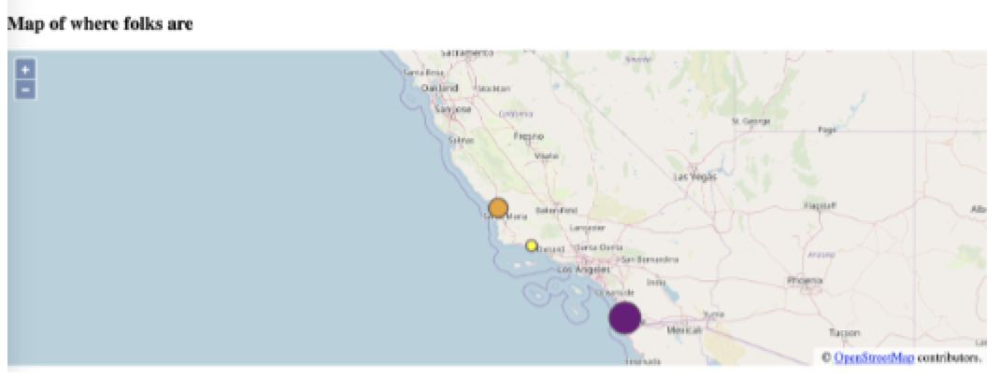

(Assignment originally created by [Dr. Zoë Wood](https://users.csc.calpoly.edu/~zwood).)

Computer science is a relatively new field and we are still figuring out how to teach it.

While this class is by no means focused _only_ on learning to program, programming is one important way in which computing professionals and enthusiasts make computers "do what they want".
We've all been programming for a while — when you have a bit of experience with programming, it can be difficult to predict or empathise with things that a novice might find difficult or outright strange about learning a programming language.

So, this assignment's goal is to examine our own programming process and to put us in (what I assume is) unfamiliar territory in terms of language and API.
We'll complete a fairly simple program — the objective here is not the program itself, but rather your documentation of your _process_ that gets you to the final program.

**Goal**: To examine and document our personal programming process.

**Process**: We will create an interactive map which shows where in the world our classmates are from. That is, you will create a map that contains a little marker for each of your lab tablemates (should be 3--5, at most).
We will accomplish using the [OpenLayers API](https://openlayers.org/) in JavaScript.
You may approach the problem using the structure proposed in the [Quick Start guide](https://openlayers.org/doc/quickstart.html).

**Spirit of the problem**: Document your coding process in detail to help us explore both the process of programming as well as the process of learning and working in unfamiliar territory.
Create a detailed list, including a list of estimated times and activities taken to achieve the final goal.
See the subset of my process anonymised as generalised activities so as not to not affect your process.

You may use AI tools to aid you, but note that the spirit of this assignment is to examine and document both the programming process and the _learning_ that takes place as your tackle the problem.
Allowing generative AI to complete the entire assignment would rob you of that learning and would lead to a rather uninteresting process document.
Remember that you're not being graded on the correctness of your final solution, so I hope you do not feel pressure to produce a finished project at all costs.

The programming specifications are as follows (intentionally general to allow you to explore your process):

* Create a webpage which draws an interactive world map using OpenLayers. The map should be centred on Cal Poly (but note that you can zoom out to accommodate a wide area).
* The map will include three different visual representations of icons used to represent where people enrolled in this class (and specifically in your “small” group) are from.
* Identify people's location based on the ESPG:4326 location of the city. You do not need to give one another your street address and may choose a closest big city if you feel more comfortable.
* The visual representations will vary based on the number of people in each area. For example, the below static image from my implementation has one person in Santa Barbara (represented by a smaller yellow icon), two people in San Luis Obispo (represented as a medium sized orange icon) and three or more people in San Diego (represented by a larger purple icon).
* You may choose a reasonable way to designate which style is associated with what number of people in that area. If your group does not have any regions with overlap, document your choice of what you will use visual style to represent and demonstrate the use of three different visual icon representations.
* You are free to choose if your code just supports a static set of locations (easier and allowed) or if you would like to generalise it to read in a list of locations.
* If you are feeling stuck, please do ping me and I can give you some hints but to start I’d like you to explore your process on your own. I will spare you one web wander and note that I found the following page useful: https://epsg.io/

**Core task**: Document your programming process in detail. Here is a sample of my process log. Please produce something similar but complete and with exact details (for example, anything labelled <task a> should have the actual feature of code you are testing) - include labels about failures and working steps, etc. Highlight key process elements. For example:

* Start 8:30
* Explore idea (waste time identifying correct API)
* Look for examples of code using identified API
* Distracted by detail of problem, looked at unrelated example implementations that sounded cool
* Try copy and pasting some example code - failed
* Look at developer view to see error
* Look for simpler example
* Copy and try again - It worked!
* Actually read the example code I got to work and think about what it is doing
* Get distracted by a detail I find interesting and think about it a bit
* Try changing example to accomplish <task a> - fail
* Try changing different part of example for <task b> - it works!
* Read documentation about <task a>, notice an error in my thinking, fix code - it works
* Create a back up of my code
* Make a major change for <task c> - fails
* Revert code to prior version
* Do more reading about API
* ....etc.... I am not listing all steps so as to not pollute your process - you should list all your steps! And what they were trying to accomplish and whether it worked or failed.
* 5 more steps and simple version of <task c> is complete—yay it worked!
* ~20 minutes messing around with <tack d> <Fill in for your exact steps - >
* ~20 minutes converting to code that generalises better for <task e>
* Done approximately 2 hours later

**Deliverable**: Turn in the following items separately in Canvas:

- A zip file containing your program. **Please do not include the `node_modules` folder in this zip file.**
- A PDF containing your process documentation and a screenshot of your completed map.
