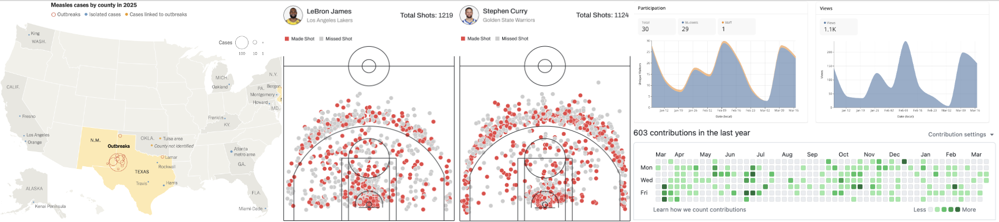

<!-- <figure>

<figcaption>Four example visualizations that I have experienced recently. (1) <a href="https://www.nytimes.com/interactive/2025/health/measles-outbreak-map.html?unlocked_article_code=1.4k4.yB2P.Mc-SFvQB5CWt&smid=url-share">NYTimes coverage of the recent Measles outbreaks.</a> (2) <a href="https://observablehq.com/d/fb34e1f49de9c53f">Shots from LeBron James and Steph Curry in the 2022-2023 season.</a> (3) EdStem traffic in my CSC 123 course in Winter 2025. (4) My GitHub contributor chart. </figcaption>
</figure> -->

From the [New York Times](https://www.nytimes.com/spotlight/graphics) to [fitness trackers](https://support.apple.com/watch/workout) and [COVID-19 dashboards](https://doh.wa.gov/emergencies/covid-19/data-dashboard#dashboard) to [Wordle shares](https://www.nytimes.com/games/wordle/index.html), the world is awash in data and visualization. In this assignment, you will reflect on and take stock of the visualizations that pervade your own life—from the practical and functional to the whimsical and fun. You’ll then analyze and critique these visualizations based on your current design knowledge.

This assignment includes a Microsoft Word template that you will use to prepare your submission (see the section on [Deliverables](#deliverables-and-grading)).

* s
{:toc}

## Part 1: Data Collection and Curation
In Part 1, take screenshots, photos, and/or videos of visualizations that you encounter in your personal, professional, and academic lives. 
Our goal with this part is to reflect on the pervasiveness of visualizations in your life, observe their use and purpose, and finally analyze them.
While you will certainly include examples of "traditional" visualizations like barcharts and the like, I encourage you to construe "data visualization" broadly—what are some different ways in which _data is presented to you graphically for the purpose of sensemaking_?

Collect a minimum of 10 visualizations and organize them in a PDF (see Deliverables). For each visualization, enter a brief description and how it relates to your life. Also include a citation to the source of the visualization if applicable.

The overall organizational approach is up to you: you could organize them by chart type, by theme (health, schoolwork, finances, fun, etc.), by communicative purpose (to inform, to persuade), etc.

## Part 2: Critique
From your collection, select three visualizations to critique and analyze. For each of the three, address questions such as:

- What is the goal of the visualization? What do you learn from it?
- How is the data represented? How do the various graphical marks and visual elements represent the data being shown?
- What are some strengths and weaknesses of the visualization? In what ways does it do a good job? How can it be improved?

The strongest submissions will directly annotate the visualization while critiquing it.

## Part 3: Learning reflection

End your document with a learning reflection (see the attached template).

## Resources
To potentially aid you in analyzing and critiquing the visualizations in your collection, here are some background readings/videos on the value of visualization, graphical composition, and the relationship between perception and visualization.

- 📹 Munzner. [Intro: Why visualize?](https://www.youtube.com/watch?v=1GhZisgc6DI&feature=youtu.be) Ch. 1 of *Visualization Analysis & Design*.
- 📹 Munzner. [Marks and channels.](https://www.youtube.com/watch?v=xplSAMwlTmY) Ch. 5 of *Visualization Analysis & Design*.
- 📜 Card, Mackinlay, Shneiderman. [Using Vision to Think](https://hci.ucsd.edu/220/CMSChap1_Using_Vision_to_Think.pdf). Ch 1. in *Readings in Information Visualization*.
- 📜 Heer, Bostock, and Ogievetsky. [A Tour Through the Visualization Zoo](https://dl.acm.org/doi/pdf/10.1145/1743546.1743567).
- 📜 Stone. [Choosing Colors for Data Visualization](https://perceptualedge.com/articles/b-eye/choosing_colors.pdf).

## Deliverables and grading
You must use [**this MS Word template**](https://cpslo-my.sharepoint.com/:w:/g/personal/ayaank_calpoly_edu/EUlwog67yZxFueIooehWZ9kBDu2WkfaRB0DEveeoBzDQ_g?e=GJ2yE1) to prepare your submission. Download a copy and then fill it in, replacing my initial examples in the process. You can make aesthetic improvements and/or add more detail, but any changes should enhance your deliverable.

When finished, export your Word Doc to a PDF and submit it in Canvas. Name the PDF `A1_YourName.pdf`.

In Part 1, you will receive 0.5 points per collected visualization + description, up to 5 points. In Part 2, 1 point per critique, up to 3 points total. In Part 3 you will receive 1 point for your learning reflection. Finally, 1 point will be reserved for excellent, well-organized, and well-communicated work.

## Acknowledgement
This assignment is based on [Jon Froehlich's original](https://docs.google.com/document/d/1--ilxp9dPmlWidmC1K_w9S5zg_UUD04QxBSnALezcxE/edit?tab=t.0).

---
