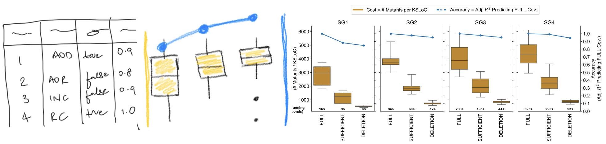

<!-- <figure>

<figcaption>
From data to sketch to figure. Figure taken from <a href="https://www.sciencedirect.com/science/article/pii/S0164121221000029?via%3Dihub">Kazerouni et al., 2021.</a>
</figcaption>
</figure> -->

- s
{:toc}

An expository article requires the author to investigate an idea, evaluate evidence, expound on the idea, and set forth an argument concerning that idea in a clear and concise manner.

In this assignment, you will
1. Design (with pen and paper) an expository visualization to clearly communicate an idea based on a provided data set,
2. Implement the visualization in an Observable notebook using Vega-Lite, and
3. Provide a rigorous rationale for your design choices. You should, in theory, be ready to explain the contribution of *every pixel* in the display towards your expository goals.

Please read these directions completely before starting.

## Deliverable

Your Deliverable in Canvas will be a URL to an Observable notebook.
The notebook will contain your pen-and-paper sketch (uploaded as an image), your Vega-Lite implementation, and your write-up describing your design rationale and the question your visualization answers.

Whether you use the [JSON syntax or the JS API](https://observablehq.com/@jonfroehlich/vega-lite-json-vs-javascript-api) for Vega-Lite is up to you.

To get started, create a new Observable Notebook and give it a useful title (don't overthink it to start with, since you will likely change it once your ideas emerge).

When you are finished, click the `🌐 Share...` button on the top right, copy the URL, and submit it in Canvas.
Please be sure to make your notebook **publicly viewable** and **unlisted**.

**Suggested imports**

It's recommended that you add a cell with the following code to import Vega-Lite.[^vl]

```js
import {vl} from "@vega/vega-lite-api-v5"
```

You may also want to import Arquero for nice table viewing:

```js
import {aq, op} from "@uwdata/arquero"
```

[^vl]: Although `vl` is available in all Observable Notebooks by default, the version imported like below comes with some goodies like nicer tooltips and scrolling enabled for very wide figures (assuming the graphic's width is justified). 


## Dataset

Computing is considered a fundamental skill for civic engagement, self-expression, and employment opportunity.
An extremely strong predictor of individuals' impressions of computing and likelihood to study computing in college is whether or not they took computing courses in high school or middle school. 

In this assignment, you are given a dataset about the demographics of K-12 CS enrolment in the state of California, kindly provided to me by the non-profit organization [CSforCA.org](https://csforca.org/), which tracks K-12 access to CS coursework in California.
<!-- Household income data was obtained from the [data.ca.gov](https://data.ca.gov) website. -->

Here are the first five records in the dataset, showing the number of students from each demographic group that were enrolled in AP CS courses, other (Non-AP) CS courses, and the total high school enrolment in that county. The report was published in 2021, and the data herein is about the 2018–2019 academic year.

| `county` | `race`           | `sex` | `AP CS` | `Non-AP CS` | `Overall Enrollment` |
| -------- | ---------------- | ----- | ------- | ----------- | -------------------- |
| Alameda  | African American | F     | 19      | 292         | 3398                 |
| Alameda  | African American | M     | 21      | 407         | 3584                 |
| Alameda  | Asian            | F     | 115     | 768         | 8367                 |
| Alameda  | Asian            | M     | 202     | 1400        | 8687                 |
| Alameda  | Filipino         | F     | 17      | 69          | 1904                 |

Add a cell with the following code to your notebook to import this data as an Arquero table.

```js
data = aq.loadJSON(
  'https://ayaankazerouni.org/courses/csc477/datasets/csforca-enrollment.json'
)  
```

Also, add a reference to the [CS Access Report](https://csforca.org/wp-content/uploads/2021/09/KC21007_CS-for-CA_9-28-21-1-1.pdf) to the bottom of your notebook, in a section titled **References**.
You should also skim the report to get a better sense of the issues at play.

While you must use this provided data-set, you are free to transform it as you see fit.
Such transforms may include (but are not limited to) tidying, log transformation, computing percentages or averages, grouping elements into new categories, or removing unnecessary variables or observations.

You're also strongly encouraged to incorporate additional external data that, when merged with the provided data, lead to interesting insights.
For example, the [data.ca.gov](https://data.ca.gov) website contains data collected by the California state government about things like household incomes in California counties, the percentage of homes with access to computers, food access, etc.

If you include additional data, your notebook should cite the source in the References section, and include a URL.  

## Assignment

Your task is to design a static (i.e., non-interactive) visualization that you believe effectively communicates an idea about the data, and provide a short write-up (no more than 4 paragraphs) describing your design.

You visualization may include multiple graphics concatenated together. We'll talk about *multi-view composition* as this assignment progresses.

### Part 1: Sketching

Start by choosing a question you'd like your visualization to answer.
You're encouraged to base your question on a combination of the provided dataset and some externally obtained data.
I advise to start with a relatively small-scope question—this assignment is fairly open-ended and I want you to spend more time on the visualization than on scouring the Web for additional data sources.

Then, design your visualization to answer that question.
Begin this process by sketching (with pen and paper!) your visualizations of the dataset.

Sketching allows us to explore initial ideas cheaply and quickly, and we also generate new ideas in the process.
Sketches are also easy to share and solicit feedback about (from each other, from me, from anyone) without heavy investment into any one idea.
Finally, research has shown that exploring several ideas in parallel can lead to better designs.[^1][^2]

[^1]: [Parallel prototyping leads to better design results, more divergence, and increased self-efficacy](https://doi.org/10.1145/1879831.1879836). Dow et al.
[^2]: [Getting the right design and the design right](https://data.ca.gov/dataset). Tohidi et al.

Your sketches do not need to include every datapoint, or even precisely represent the data.
The goal at this point is to think about data representation, communicating through visualization and sketching different visualization designs.
I encourage you to use sharpies, colour pencils, or pens to control line thicknesses and colours.

### Part 2: Implementation

Once you've arrived at an idea or set of ideas, implement them using Vega-Lite.
You will likely iterate further on your designs in this stage. _That's fine_.
There's no requirement that your final design look exactly like your sketch.

Your graphic should be interpretable without recourse to your write-up (see below).
Don't forget to include title, axis labels, or legends as needed!

Remember that the goal for this assignment is a _static_ visualization (potentially made up of multiple layered or concatenated views).

### Part 3: Write-up

As different visualizations can emphasise different aspects of a data set, your write-up should document what aspects of the data you are attempting to most effectively communicate.
In short, what story are you trying to tell?
Just as important, also note which aspects of the data might be obscured due to your visualization design.

Your write-up should provide a rigorous rationale for your design decisions.
Document the visual encodings you used and why they are appropriate for the data and your specific question.
These decisions include the choice of visualization type, size, colour, scale, and other visual elements, as well as the use of sorting or other data transformations.
How do these decisions facilitate effective communication?

Finally, although this assignment is organised into three parts, that is only a guideline.
You are free to organize your notebook however you wish—whatever best communicates your exposition.

## Grading

The assignment score is out of a maximum of 10 points. I will determine scores by judging both the **soundness of your design** and the **overall presentation and quality of the write-up.**
I will also look for consideration of audience, message, and intended task.
Here are examples of aspects that may lead to point deductions:

- Use of misleading, unnecessary, or unmotivated graphic elements. 
- Missing chart title, axis labels, or data transformation description.
- Ineffective encodings for your stated goal (e.g., distracting colours, improper data transformation). 
- Missing or incomplete design rationale in write-up.
- Missing references for external data.
- Excessive grammar mistakes/lack of proofreading in the write-up.

Examples of going above and beyond the assignment requirements include: entries with outstanding visual design, meaningful incorporation of external data and context to reveal and explain important trends, entries that demonstrate exceptional creativity, or effective annotations and other narrative devices.

## Resources

- [Vega-Lite documentation](https://vega.github.io/vega-lite/) (JSON syntax).
- Vega-Lite JS [API reference](https://vega.github.io/vega-lite-api/api/) and [Example gallery](https://observablehq.com/@vega/vega-lite-api-v5?collection=@vega/vega-lite-api).
- [CS for CA website](https://csforca.org), containing the report and other graphics that may give you ideas.
- [California government data](https://data.ca.gov). Data at this website is often already broken down by county, making it convenient to pair with the provided dataset.

## Acknowledgement

This assignment is adapted from similar assignments from [Jeffrey Heer](https://courses.cs.washington.edu/courses/cse442/24au/a1.html) and [Jon Froehlich](https://docs.google.com/document/d/1k4WHViGAGRN02-kNpxR2J2aTWZg1LhDf6MgbgYMqM88/edit?tab=t.0#heading=h.5q6g0flf43al).

---
